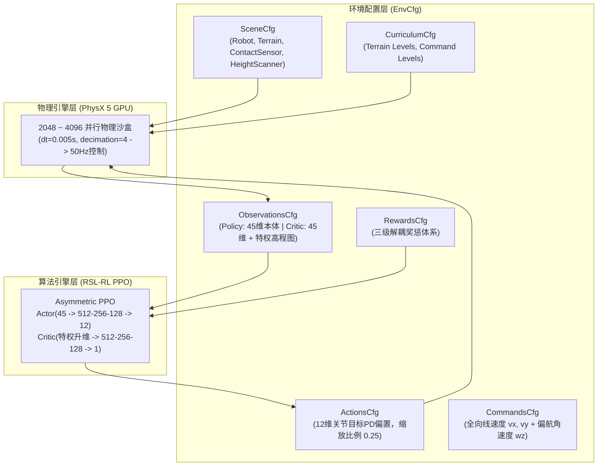
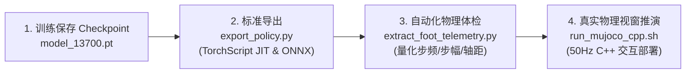
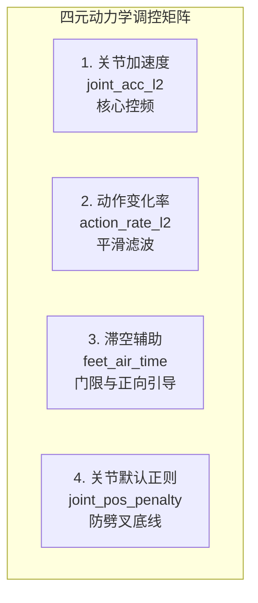
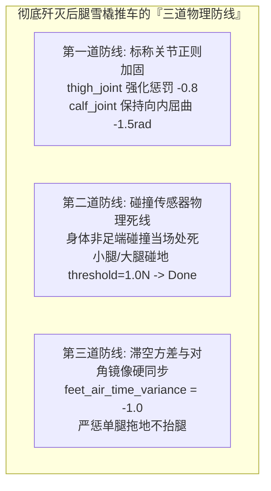
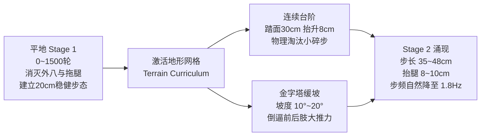
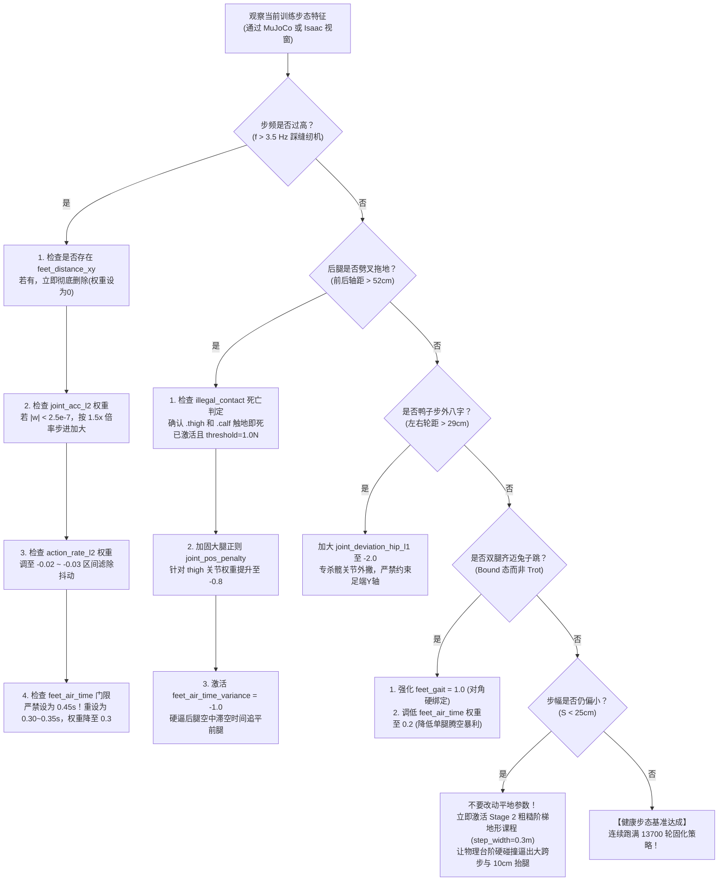

# Unitree Go2 robot_lab (Isaac Lab + RSL-RL) 标准化训练路线与避坑实战手册 (Production SOP & Diagnostic Guide)

> **文档定位**：本手册是 Unitree Go2 基于 **robot_lab（NVIDIA Isaac Lab 架构 + ETH RSL-RL 并行强化学习）** 进行纯本体感觉盲走与越障运控开发的**工业级生产实战与标准化训练路线手册（Standard Operating Procedure）**。
> **编制依据**：结合 `fan-ziqi/robot_lab` 官方开源标杆（13700 轮全地形预训练基准）、NVIDIA Isaac Lab 管理器设计规范、苏黎世联邦理工（ETH Zurich）RSL 实验室核心运控原理，以及我们在全量迭代调试中亲历的血泪教训、物理病理遥测与动力学诊断。
> **核心宗旨**：**正本清源，彻底砸碎“平地打补丁式变形微调”与“伪奖励套利”，指导未来四足机器人从第 0 步开始，走出昂首挺拔、对称清脆、步幅舒展（35~50cm）、从容优雅（1.0~1.8Hz）的黄金对角 Trot 步态，并具备跨越台阶碎石的强悍全地形泛化力。**

---

## 目录

- [一、 官方路线的设计哲学与第一性原理](#一-官方路线的设计哲学与第一性原理)
  - [1.1 什么是 robot_lab：基于 Isaac Lab 管理器架构与 RSL-RL](#11-什么是-robot_lab基于-isaac-lab-管理器架构与-rsl-rl)
  - [1.2 官方路线的第一性原理：非对称特权 Critic 与自然物理边界](#12-官方路线的第一性原理非对称特权-critic-与自然物理边界)
  - [1.3 45 维本体感知盲走与 12 关节力矩控制闭环](#13-45-维本体感知盲走与-12-关节力矩控制闭环)
- [二、 标准全生命周期四阶段训练路线（Standard 4-Stage Roadmap）](#二-标准全生命周期四阶段训练路线standard-4-stage-roadmap)
  - [Stage 0：环境搭建、物理参数与电机关节零位对齐](#stage-0环境搭建物理参数与电机关节零位对齐)
  - [Stage 1：平地纯净 Trot 冷启动与体态基线定型（0 ~ 1500 轮）](#stage-1平地纯净-trot-冷启动与体态基线定型0--1500-轮)
  - [Stage 2：地形动态爬升课程与大跨步自然倒逼（1500 ~ 5000 轮）](#stage-2地形动态爬升课程与大跨步自然倒逼1500--5000-轮)
  - [Stage 3：连续 10~15cm 台阶与复杂起伏极限越障攻坚（5000 ~ 10000 轮）](#stage-3连续-1015cm-台阶与复杂起伏极限越障攻坚5000--10000-轮)
  - [Stage 4：全向速度盲走、抗扰自愈与 13700+ 轮终极固化](#stage-4全向速度盲走抗扰自愈与-13700-轮终极固化)
- [三、 历史血泪教训：六大“短期见效、长期带毒”的打补丁操作深度复盘](#三-历史血泪教训六大短期见效长期带毒的打补丁操作深度复盘)
  - [陷阱 1：人工静态 2D 空间方盒 `feet_distance_xy_exp`（步幅坍塌至 12cm，步频飙升至 7Hz 踩缝纫机）](#陷阱-1人工静态-2d-空间方盒-feet_distance_xy_exp步幅坍塌至-12cm步频飙升至-7hz-踩缝纫机)
  - [陷阱 2：一刀切完全解开 X 轴（前后轴距劈叉拉长至 65.4cm，后腿 90° 直角雪橇拖曳推车）](#陷阱-2一刀切完全解开-x-轴前后轴距劈叉拉长至-654cm后腿-90-直角雪橇拖曳推车)
  - [陷阱 3：超大门限暴力拉扯 `feet_air_time`（初始探索全负焦土、策略早衰与痉挛起跳代偿）](#陷阱-3超大门限暴力拉扯-feet_air_time初始探索全负焦土策略早衰与痉挛起跳代偿)
  - [陷阱 4：平地世界坐标刚性焊死 `base_height` / `flat_orientation`（剥夺倒立摆储能，逼出小腿高频震颤）](#陷阱-4平地世界坐标刚性焊死-base_height--flat_orientation剥夺倒立摆储能逼出小腿高频震颤)
  - [陷阱 5：静态绝对高度抬腿惩罚 `feet_height`（破坏落足抛物线，触地前反向抽腿与打滑软脚）](#陷阱-5静态绝对高度抬腿惩罚-feet_height破坏落足抛物线触地前反向抽腿与打滑软脚)
  - [陷阱 6：急躁打断多阶段生长规律（在 500 轮求生期反复推倒重来，破坏相变）](#陷阱-6急躁打断多阶段生长规律在-500-轮求生期反复推倒重来破坏相变)
- [四、 常见异常步态病灶快速诊断与处方手册（Diagnostic Playbook）](#四-常见异常步态病灶快速诊断与处方手册diagnostic-playbook)
  - [病灶 1：踩缝纫机式 5~7Hz 高频小碎步（步幅严重不足，频率失控）](#病灶-1踩缝纫机式-57hz-高频小碎步步幅严重不足频率失控)
  - [病灶 2：后腿 90° 直角后展拖地推车（Wheelbarrow 推车效应，轴距超长）](#病灶-2后腿-90-直角后展拖地推车wheelbarrow-推车效应轴距超长)
  - [病灶 3：严重外八字脚（鸭子步、后肢轮距超宽、两腿外翻）](#病灶-3严重外八字脚鸭子步后肢轮距超宽两腿外翻)
  - [病灶 4：Bound 兔跳（双前腿同起同落、双后腿同蹬同推）](#病灶-4bound-兔跳双前腿同起同落双后腿同蹬同推)
  - [病灶 5：屁股严重下沉低趴或后仰朝天（高度丢失与俯仰失衡）](#病灶-5屁股严重下沉低趴或后仰朝天高度丢失与俯仰失衡)
  - [病灶 6：单腿高频乱蹬推车而其余腿正常（对角镜像与节拍不同步）](#病灶-6单腿高频乱蹬推车而其余腿正常对角镜像与节拍不同步)
  - [病灶 7：遇微小台阶绊脚磕碰（落足安全净空与高程估计断层）](#病灶-7遇微小台阶绊脚磕碰落足安全净空与高程估计断层)
- [五、 官方黄金标准奖励函数体系与超参基线（Clean Reward Reference）](#五-官方黄金标准奖励函数体系与超参基线clean-reward-reference)
  - [5.1 官方推荐核心奖励项清单与标准权重](#51-官方推荐核心奖励项清单与标准权重)
  - [5.2 严禁启用的“黑名单”人工补丁项](#52-严禁启用的黑名单人工补丁项)
- [六、 交付部署与质检规范（Sim2Sim & Sim2Real SOP）](#六-交付部署与质检规范sim2sim--sim2real-sop)
  - [6.1 导出标准 TorchScript JIT / ONNX 规范](#61-导出标准-torchscript-jit--onnx-规范)
  - [6.2 MuJoCo 自动化全量动力学质检指标体系](#62-mujoco-自动化全量动力学质检指标体系)
  - [6.3 C++ 工业级低延迟部署闭环与手柄映射契约](#63-c-工业级低延迟部署闭环与手柄映射契约)
- [七、 核心攻坚专项：1.0~1.8Hz 从容大步态与防后腿劈叉的力学调控工程指南（免踩坑终极详解）](#七-核心攻坚专项1018hz-从容大步态与防后腿劈叉的力学调控工程指南免踩坑终极详解)
  - [7.1 步频-步幅动力学第一性原理：v = S · f 的能量天平](#71-步频-步幅动力学第一性原理v--s--f-的能量天平)
  - [7.2 四大平滑与能耗惩罚参数的敏感度分析与黄金甜点区（Sweet Spot）](#72-四大平滑与能耗惩罚参数的敏感度分析与黄金甜点区sweet-spot)
  - [7.3 彻底杜绝后腿雪橇推车（Wheelbarrow）的“三道物理防线”调参实战](#73-彻底杜绝后腿雪橇推车wheelbarrow的三道物理防线调参实战)
  - [7.4 Stage 1 到 Stage 2 地形课程（Curriculum）精确网格与晋级阈值深度拆解](#74-stage-1-到-stage-2-地形课程curriculum精确网格与晋级阈值深度拆解)
  - [7.5 步态调优实战工程决策树（Diagnostic Decision Flowchart）](#75-步态调优实战工程决策树diagnostic-decision-flowchart)
  - [7.6 终极开箱即用：零补丁标准 Rewards 模块与超参配置完整代码范本](#76-终极开箱即用零补丁标准-rewards-模块与超参配置完整代码范本)

---

## 一、 官方路线的设计哲学与第一性原理

### 1.1 什么是 robot_lab：基于 Isaac Lab 管理器架构与 RSL-RL

`robot_lab`（本地路径 `/home/rum/isaac/robot_lab`）是全网主流的现代四足/双足强化学习工业级开源工程，其底层架构完全遵循 NVIDIA Isaac Lab 的**管理器架构（Manager-Based Workflow）**与苏黎世联邦理工（ETH Zurich）的 **RSL-RL（PPO）** 算法底座。



### 1.2 官方路线的第一性原理：非对称特权 Critic 与自然物理边界

许多开发者容易误入歧途：**企图在平地上用复杂的数学奖惩公式去“画”出一只漂亮行走的狗子**。但四足机器人官方路线的第一性原理是：
1. **不要代替物理引擎做决定**：
   * 强化学习必须靠**物理边界（障碍碰撞、关节机械极限、力矩做功能耗）**来约束行为，而不是靠人类主观画出的虚拟空间框。
2. **非对称特权训练（Asymmetric Training）**：
   * **Actor（策略网络）**：只能接收 45 维纯本体感觉（IMU 姿态与角速度、关节编码器位置与速度、历史动作、速度指令）。这保证了模型能直接无缝刷入真机（Sim2Real Zero-Shot），不需要激光雷达或深度相机。
   * **Critic（价值网络）**：在仿真阶段可以无偿读取全知特权信息（机体下方特权高程图扫描、全局线速度、地面接触力）。Critic 凭借特权信息精准评估未来回报，指导 Actor 快速跨越盲区，彻底避免由于信息不完全导致的价值估计崩溃。
3. **真实地形倒逼步态进化（Terrain Drives Gait）**：
   * 在平地上，贴地 6Hz 碎步做功最小且零摔倒风险，是能耗局部的“最优解”；
   * 只有在台阶、斜坡与碎石坑中，脚抬低了会撞台阶处死，步子迈小了会掉进坑里处死。**物理地形的硬碰撞，才能自然倒逼出高抬腿和大跨步**。

### 1.3 45 维本体感知盲走与 12 关节力矩控制闭环

官方 `robot_lab` 遵循严格的 50Hz 运控闭环标准契约：

| 索引区间 | 观测分量 (Observation) | 维度 | 缩放系数 (Scale) | 物理意义 |
| :--- | :--- | :--- | :--- | :--- |
| `0 : 3` | `base_ang_vel` | 3 | $0.25$ | 局部机身坐标系下的角速度 (陀螺仪) |
| `3 : 6` | `projected_gravity` | 3 | $1.0$ | 重力加速度在机身坐标系的投影向量 (姿态与倾角) |
| `6 : 9` | `velocity_commands` | 3 | $1.0$ | 目标速度指令 $[v_x, v_y, \omega_z]$ |
| `9 : 21` | `joint_pos - default_joint_pos` | 12 | $1.0$ | 12 个关节相对于默认站立姿态的相对角位移 |
| `21 : 33` | `joint_vel` | 12 | $0.05$ | 12 个电机的瞬时转速 |
| `33 : 45` | `actions` (last action) | 12 | $1.0$ | 上一控制周期输出的 12 维动作缓存 |

* **执行器驱动闭环**：
  $$q_{\text{target}} = q_{\text{default}} + 0.25 \times \text{action}$$
  $$\tau = K_p (q_{\text{target}} - q) - K_d \dot{q}, \quad (K_p = 25.0, K_d = 0.5, \tau_{\text{limit}} = 23.5\text{ N}\cdot\text{m})$$

---

## 二、 标准全生命周期四阶段训练路线（Standard 4-Stage Roadmap）


### Stage 0：环境搭建、物理参数与电机关节零位对齐
在启动训练前，必须确保仿真模型与实物真机底层拓扑 100% 契约一致：
1. **关节排列拓扑核验**：
   * `robot_lab` 内部标准为：`FR(hip, thigh, calf), FL(hip, thigh, calf), RR(hip, thigh, calf), RL(hip, thigh, calf)`；
   * 默认站立标称角度严格对齐：
     $$q_{\text{default}} = [0.0, 0.8, -1.5, \quad 0.0, 0.8, -1.5, \quad 0.0, 0.8, -1.5, \quad 0.0, 0.8, -1.5]\text{ rad}$$
2. **标称空间几何参数**：
   * 前后髋关节距离（Wheelbase 轴距）：$38.68\text{ cm}$；
   * 左右髋关节距离（Track 轮距）：$19.00\text{ cm}$（足端自然开度约 $26 \sim 28\text{ cm}$）；
   * 大腿连杆长度 $L_1 = 21.3\text{ cm}$，小腿连杆长度 $L_2 = 21.3\text{ cm}$。

---

### Stage 1：平地纯净 Trot 冷启动与体态基线定型（0 ~ 1500 轮）
* **核心任务**：建立平衡置信度，形成端正对角节拍，消灭外八字与后腿拖地。
* **环境配置**：
  * 地形设为平面（`plane`）或超平缓起伏（Level 0）；
  * 启用纯净奖励组合：
    * `track_lin_vel_xy_exp`: 4.0
    * `feet_gait`: 1.5（对角 [FL+RR] 与 [FR+RL] 硬同步）
    * `joint_mirror`: -0.1（对角关节对称）
    * `joint_deviation_hip_l1`: -1.5（死锁髋关节外偏，消灭外八字）
    * `joint_pos_penalty`: -0.5（默认关节 L2 正则，焊死后大腿直角翻折）
    * `undesired_contacts`: -2.0（小腿触地即死，消灭跪坐与低趴塌陷）
* **演化里程碑**：
  * 第 500 轮：机器人能够平稳站立行走，无剧烈颠簸摔倒；
  * 第 1500 轮：步态形成纯正对角交替，有效前后轴距稳定在 $42 \sim 48\text{ cm}$，左右轮距维持在 $26 \sim 28\text{ cm}$，外八字彻底消除。

---

### Stage 2：地形动态爬升课程与大跨步自然倒逼（1500 ~ 5000 轮）
* **核心任务**：激活地形课程（`terrain_levels`），利用粗糙路面与碎石障碍倒逼腿部自然前后甩大步、提高足端离地净空。
* **课程阶梯注入**：
  * 打开 `terrain_generator`，包含：
    * 平滑起伏路（波长 1.0m，高度 5cm）；
    * 离散凸起石块（高度 3~8cm）；
    * 温和阶梯（踏面 30cm，抬升 5~8cm）。
* **动力学机制**：
  * 在凹凸地形中，如果足端滞空时间过短或贴地滑行，脚尖会频繁碰撞障碍边缘；
  * 网络在力矩惩罚与生存奖励的博弈下，自发将单步滞空时间从 80ms 延长至 $200 \sim 300\text{ ms}$，步频自发从 5Hz 放缓至 $2.2 \sim 2.8\text{ Hz}$，步长自发展开至 $30 \sim 40\text{ cm}$。

---

### Stage 3：连续 10~15cm 台阶与复杂起伏极限越障攻坚（5000 ~ 10000 轮）
* **核心任务**：挑战高难台阶，固化高抬腿与抗撞击着地缓冲能力。
* **课程进阶**：
  * 引入连续上楼梯与下楼梯（金字塔阶梯与倒金字塔阶梯，高度达 $10 \sim 15\text{ cm}$）；
  * 开启 `command_levels_lin_vel` 速度递进课程：速度指令从 $0.5\text{ m/s}$ 动态拓展至 $1.5\text{ m/s}$。
* **现象验收**：
  * 狗子在跨越连续 10cm 台阶时，前腿足端离地腾空高度自然达到 $8 \sim 12\text{ cm}$；
  * 后腿保持紧凑前收，绝无拖尾或卡死在台阶边缘的现象。

---

### Stage 4：全向速度盲走、抗扰自愈与 13700+ 轮终极固化
* **核心任务**：全向抗扰与能耗极小化，消除多余关节高频震颤，达成官方 13700 轮黄金交付基准。
* **训练要点**：
  * 随机注入外部推力扰动（`push_robots`: 速度脉冲 $0.5 \sim 1.0\text{ m/s}$，周期 8 秒）；
  * 速度指令完全放开为全向：$v_x \in [-1.0, 1.5]\text{ m/s}, v_y \in [-0.6, 0.6]\text{ m/s}, \omega_z \in [-1.2, 1.2]\text{ rad/s}$；
  * 运行满 13700 轮后，策略权重深层动力学完全冻结，导出最终发布版本。

---

## 三、 历史血泪教训：六大“短期见效、长期带毒”的打补丁操作深度复盘

### 陷阱 1：人工静态 2D 空间方盒 `feet_distance_xy_exp`（步幅坍塌至 12cm，步频飙升至 7Hz 踩缝纫机）
* **操作**：用高斯函数在局部坐标系下强求足端处于 $(\pm 0.20, \pm 0.14)$。
* **表象见效**：迅速压制了后腿后拖和外八字，前后轴距瞬间显示为规整的 42cm。
* **长期死穴**：
  迈步摆动本质是足端相对于质心前后 $\pm 25\text{ cm}$ 的大幅度周期扫掠。方盒惩罚在每一步迈出时持续扣分，网络为了赚取静态位置分，**主动将前后摆幅压缩为仅 $\pm 5\text{ cm}$（步幅仅 12cm）**。根据物理定律 $v = S \times f$，为了维持车速，**步频被逼疯涨至 6.5Hz 极高频碎步（踩缝纫机）**！
* **官方做法**：绝不设静态 X-Y 足端方盒！只约束髋关节侧向旋转（`joint_deviation_hip_l1 = -1.5`），前后纵向完全交由动力学自由摆动。

---

### 陷阱 2：一刀切完全解开 X 轴（前后轴距劈叉拉长至 65.4cm，后腿 90° 直角雪橇拖曳推车）
* **操作**：把 X 轴约束彻底清零，且削弱关节默认正则。
* **表象见效**：摆幅束缚解开，前腿步幅有所增加。
* **长期死穴**：
  网络立刻挖掘出力学漏洞：**把后大腿拉到 $90^\circ$ 直角平展在身后（后足 $-41\text{ cm}$），将前后支撑面拉长到 65.4cm 当雪橇拖行**！右后腿静态滑地支撑，左后腿以 4.88Hz 在身后乱蹬推车。这种姿态永远不会后仰摔倒，网络躺赚高额速度分，轴距彻底劈叉畸变。
* **官方做法**：依靠 `joint_pos_penalty = -0.5` 坚决惩罚大腿后展超过 $65^\circ$，配合 `undesired_contacts = -2.0`（小腿擦地即死），彻底堵死雪橇推车后路。

---

### 陷阱 3：超大门限暴力拉扯 `feet_air_time`（初始探索全负焦土、策略早衰与痉挛起跳代偿）
* **操作**：为了要 1.0Hz，直接在平地硬设 `threshold = 0.45s`，权重达 4.0。
* **表象见效**：单步滞空被逼延长至 136ms，步频从 7Hz 下降至 3.5Hz。
* **长期死穴**：
  初始随机探索期单步滞空仅 60ms，导致落地时遭受高达 $-1.6$ 的重惩罚，环境初始奖励退化为大面积全负焦土。策略网络为凑足 450ms 滞空，极易学会双腿同跳（Bound）、躯干剧烈扭晃等畸形特技，且落足前心生畏惧不敢果断蹬地。
* **官方做法**：权重只设温和的 `0.1 ~ 0.5`，门限设为常规的 `0.25 ~ 0.35s`，仅用来防止拖拉步。慢步频靠**关节力矩惩罚与加速度惩罚（碎步极其耗能）**自然倒逼出来。

---

### 陷阱 4：平地世界坐标刚性焊死 `base_height` / `flat_orientation`（剥夺倒立摆储能，逼出小腿高频震颤）
* **操作**：在世界系下强行惩罚高度偏差（目标 32cm，权重 -2.0）和俯仰偏差（权重 -2.0）。
* **表象见效**：机身看似昂首挺拔，完全水平。
* **长期死穴**：
  四足迈步必须伴随重心微小的垂直沉降与小角度俯仰（倒立摆蓄能与释放）。强行焊死姿态，导致大腿不敢深屈伸，小腿只能以 6Hz 高频极微行程“踮脚尖微震”来维持虚假恒高。遇到真实台阶或上下坡时，绝对水平惩罚直接导致机器人前扑或后仰摔死。
* **官方做法**：高度由机载传感器（Height Scanner）测算相对于局部地面的相对净空，并主要依靠**小腿/腹部触地即死（`undesired_contacts`）**防塌陷，赋予机身自然的倒立摆储能弹性。

---

### 陷阱 5：静态绝对高度抬腿惩罚 `feet_height`（破坏落足抛物线，触地前反向抽腿与打滑软脚）
* **操作**：设定摆腿必须达到世界坐标 8cm，否则扣分。
* **表象见效**：前腿空摆时看起来有抬腿动作。
* **长期死穴**：
  正常落足轨迹是平滑抛物线下落触地。强制要求保持 8cm，导致脚在即将触地支撑时因低于 8cm 再次吃惩罚。网络发生决策神经冲突：在脚接触地面瞬间突然反向抽腿缩脚，引发严重踩空打滑（Foot Slide）与落地软脚。
* **官方做法**：官方完全弃用 `feet_height`（权重为 0）！靠**真实 10cm 台阶地形的刚性几何碰撞**去教狗子抬腿，物理法则天然雕刻出完美抛物线。

---

### 陷阱 6：急躁打断多阶段生长规律（在 500 轮求生期反复推倒重来，破坏相变）
* **操作**：在 400~500 轮看到步态出现某些不尽如人意的过渡态，就中断训练推倒重来。
* **表象见效**：每次换超参都能在几百轮内看到某个单一数值的变化。
* **长期死穴**：
  强化学习具有固定的“求生期（0~1000轮）→ 去冗余期（1000~4000轮）→ 动力学最优固化期（4000~13700轮）”生长周期。在 500 轮网络刚摸索出防摔平衡时就强行干预，等于反复把刚破土的幼苗拔出来重栽，策略永远无法进入深层动作平滑相变。
* **官方做法**：定好纯净规则底座后，**连续跑满 13700 轮（逾 15 亿步）**，给网络充足的自愈与优化时间常数。

---

## 四、 常见异常步态病灶快速诊断与处方手册（Diagnostic Playbook）

| 异常病灶表象 | 核心力学诱因剖析 | 错误排查方向 | 官方正规军标准处方 |
| :--- | :--- | :--- | :--- |
| **1. 踩缝纫机式 5~7Hz 高频小碎步** | 步幅被静态空间框或高位置惩罚锁死；缺少动作平滑与力矩加速度惩罚 | 误以为是滞空时间权重不够，暴力拉高 `air_time` | ① 彻底移除 `feet_distance_xy_exp`；<br>② 适当松绑大腿关节正则；<br>③ 强化 `joint_acc_l2 (-2.5e-7)` 与 `action_rate_l2 (-0.02)`，逼迫网络为了节能自发放慢步频、甩开大步。 |
| **2. 后腿 90° 直角后展拖地推车 (65cm 劈叉)** | 纵向 X 轴完全失控，大腿回正惩罚过弱，网络通过拉长前后基底建立绝对防跌倒后门 | 误用静态 X 轴方框去硬圈足端位置 | ① 恢复全局默认关节正则 `joint_pos_penalty = -0.5`；<br>② 启用小腿/大腿触地即死 `undesired_contacts = -2.0`；<br>③ 强化 `joint_mirror` 对角对称约束。 |
| **3. 鸭子步严重外八字 (后肢轮距超宽)** | 髋关节偏航/横滚自由度缺乏硬惩罚，网络外撇双腿以扩大侧向支撑面防侧翻 | 误去约束足端 Y 轴静态距离 | ① 强化髋关节专用正则 `joint_deviation_hip_l1 = -1.5`（专杀髋电机外撇）；<br>② 保持左右轮距自然收拢在 $26 \sim 28\text{ cm}$。 |
| **4. Bound 兔跳 (双前腿齐迈、双后腿齐蹬)** | 步态对角相位同步机制缺失，前后对称兔跳在直线上对称性好但非 Trot | 试图加单腿滞空惩罚 | ① 启用对角相位硬锁 `feet_gait = 0.5 ~ 1.5`（绑定 [FL+RR] 与 [FR+RL]）；<br>② 启用对角关节镜像 `joint_mirror = -0.05 ~ -0.1`。 |
| **5. 屁股严重下沉低趴或后仰朝天** | 重心高度缺乏相对地形基准，缺少小腿触地惩罚导致屈膝瘫软逃避做功 | 用世界绝对坐标高度死死焊死高度 | ① 启用 `height_scanner` 相对高程扫描；<br>② 启用 `undesired_contacts = -2.0`（小腿碰地当场处死，逼出挺直站立）。 |
| **6. 单腿乱蹬推车而其余腿正常** | 单腿陷入局部高频推进代偿，对角腿未能形成 100% 镜像约束 | 针对单腿单独写扣分项 | ① 坚决加大 `joint_mirror = -0.1`；<br>② 启用 `feet_air_time_variance = -1.0`（惩罚四腿滞空时间方差，四腿必须步调绝对一致）。 |
| **7. 遇微小台阶绊脚磕碰** | 纯平地训练未见识过障碍物，策略形成贴地扫地拖步的侥幸坏习惯 | 用纯数学公式 `feet_height` 强行拉抬腿 | ① 切换进入 `rough_env_cfg` 台阶生成器；<br>② 设置连续 5~10cm 阶梯，以真实几何物理碰撞倒逼足端划出高抬抛物线。 |

---

## 五、 官方黄金标准奖励函数体系与超参基线（Clean Reward Reference）

### 5.1 官方推荐核心奖励项清单与标准权重
以下为 `/home/rum/isaac/robot_lab` 在 Unitree Go2 上历经 13700 轮检验的**黄金基线配置**（位于 `rough_env_cfg.py`）：

```python
# ------------------------------任务层：速度追踪 (Task Tracking)------------------------------
self.rewards.track_lin_vel_xy_exp.weight = 4.5        # 指数型平面线速度追踪 (std = 0.5)
self.rewards.track_ang_vel_z_exp.weight = 1.5         # 指数型偏航角速度追踪 (std = 0.5)

# ------------------------------步态层：对角 Trot 拓扑硬锁 (Gait & Symmetry)------------------------------
self.rewards.feet_gait.weight = 0.5                   # 显式对角对接触/滞空硬同步
self.rewards.feet_gait.params["synced_feet_pair_names"] = (("FL_foot", "RR_foot"), ("FR_foot", "RL_foot"))
self.rewards.joint_mirror.weight = -0.05              # 对角关节镜像差值二次方惩罚
self.rewards.joint_mirror.params["mirror_joints"] = [
    ["FR_(hip|thigh|calf).*", "RL_(hip|thigh|calf).*"],
    ["FL_(thigh|calf).*", "RR_(thigh|calf).*"],
]
self.rewards.feet_air_time_variance.weight = -1.0     # 四腿空中时间方差惩罚 (彻底消灭单腿乱蹬)
self.rewards.feet_air_time.weight = 0.5               # 温和滞空奖励 (threshold = 0.35s，防拖拉扫地)

# ------------------------------姿态与几何：挺拔无外八 (Posture & Alignment)------------------------------
self.rewards.base_height_l2.weight = -1.5             # 相对地表高度惩罚 (target = 0.30m)
self.rewards.flat_orientation_l2.weight = -2.0        # 机身水平俯仰/横滚正则
self.rewards.create_joint_deviation_l1_rewterm("joint_deviation_hip_l1", -1.5, [".*_hip_joint"]) # 专杀外八字
self.rewards.joint_pos_penalty.weight = -0.5          # 全局关节默认姿态正则 (焊死后腿向后平翻)

# ------------------------------平滑与能耗：倒逼慢步频 (Smoothness & Energy)------------------------------
self.rewards.action_rate_l2.weight = -0.02            # 动作变化率惩罚 (平滑输出，杜绝高频振颤)
self.rewards.joint_acc_l2.weight = -2.5e-7            # 关节加速度惩罚 (逼退小碎步，诱导大步长)
self.rewards.joint_torques_l2.weight = -2.5e-5        # 关节力矩能耗惩罚
self.rewards.joint_pos_limits.weight = -5.0           # 机械软限位惩罚

# ------------------------------硬性物理死亡边界 (Hard Failure Boundaries)------------------------------
self.rewards.undesired_contacts.weight = -2.0         # 小腿、大腿、腹部异常触地扣分
self.terminations.illegal_contact.params["sensor_cfg"].body_names = [
    self.base_link_name, ".*_thigh", ".*_calf.*"      # 非足端碰撞立即处死重置
]
```

### 5.2 严禁启用的“黑名单”人工补丁项

> [!CAUTION]
> 在未来的任何四足训练中，**严禁再次引入以下伪奖励项**：
> 1. ❌ **`feet_distance_xy_exp`**：静态足端方框，必定导致步幅坍塌至 12cm、步频被迫飙升至 7Hz；
> 2. ❌ **超大门限 `feet_air_time`（门限 > 0.40s 且权重 > 2.0）**：导致初始探索陷入全负焦土，诱发兔子跳与全身抽搐；
> 3. ❌ **世界绝对高度 `feet_height`**：破坏自然落足抛物线，导致触地前神经冲突反向抽腿与打滑；
> 4. ❌ **世界绝对坐标刚性姿态死锁**：抹杀倒立摆自然储能起伏，使策略在真实地形与斜坡上瞬间暴毙。

---

## 六、 交付部署与质检规范（Sim2Sim & Sim2Real SOP）

所有在 `/home/rum/isaac/robot_lab` 下训练成熟的策略，必须严格遵循以下三步验收流程方可实机交付：



### 6.1 导出标准 TorchScript JIT / ONNX 规范
使用官方封装导出工具，实现零依赖纯 CPU/GPU 独立推演：
```bash
/home/rum/isaac/robot_lab/tool/export_policy.py \
    --checkpoint /home/rum/isaac/robot_lab/logs/rsl_rl/unitree_go2_rough/<EXPERIMENT_DIR>/model_xxxx.pt \
    --output_dir /home/rum/isaac/robot_lab/logs/rsl_rl/unitree_go2_rough/<EXPERIMENT_DIR>/exported
```
* **数值核验红线**：JIT 与 ONNX 的最大前向绝对误差必须小于 $10^{-5}$。

### 6.2 MuJoCo 自动化全量动力学质检指标体系
运行深度物理诊断脚本，彻底终结目测盲猜：
```bash
/home/rum/env_isaaclab/bin/python /home/rum/isaac/robot_lab/tool/extract_foot_telemetry.py \
    --model_dir /home/rum/isaac/robot_lab/logs/rsl_rl/unitree_go2_rough/<EXPERIMENT_DIR>/exported \
    --vx 0.8
```

* **合格交付硬性量化指标门槛**：
  * **前后有效轴距 (Wheelbase)**：严格位于 **$40 \sim 50\text{ cm}$** 之间（严禁超过 55cm，杜绝拖腿劈叉）；
  * **左右横向轮距 (Track)**：严格位于 **$25 \sim 29\text{ cm}$** 之间（后肢严禁超过 30cm，杜绝外八字）；
  * **四足步频一致性**：四条腿步频极差小于 $0.3\text{ Hz}$（杜绝单腿乱蹬与跛行）；
  * **单步步幅**：在 $0.8\text{ m/s}$ 航速下，单步步长必须大于 **$25\text{ cm}$**（杜绝 15cm 以下碎步）；
  * **机身高度与水平度**：底盘离地间隙 $27 \sim 32\text{ cm}$，直线横向漂移 $v_y < 0.05\text{ m/s}$。

### 6.3 C++ 工业级低延迟部署闭环与手柄映射契约
终检确认无误后，直接在宿主终端拉起 3D C++ 真实物理部署视窗：
```bash
bash /home/rum/isaac/robot_lab/tool/run_mujoco_cpp.sh 0.8
```
* 支持键盘 `[W/S]` 实时增减巡航速度，`[A/D]` 转向偏航，`[空格]` 瞬态急停，`[R]` 初始姿态复位。在完全脱离 Python 与 Isaac Sim 的独立纯 C++ 物理世界中，验收其真实步态的刚健与从容。

---

## 七、 核心攻坚专项：1.0~1.8Hz 从容大步态与防后腿劈叉的力学调控工程指南（免踩坑终极详解）

> **本章核心解决两大工程死结**：
> 1. 为什么无论怎么调参数，四足总是趋向于 **5~7Hz 踩缝纫机式高频小碎步**？如何不加任何静态足端方框，仅靠动力学规律实现 **1.0~1.8Hz 从容大跨步（35~50cm 步幅）**？
> 2. 为什么放开关节正则后，四足必定滑向 **后腿 90° 伸直拖地推车（Wheelbarrow 65.4cm 劈叉）**？如何构建“三道物理防线”将其彻底扑杀？

---

### 7.1 步频-步幅动力学第一性原理：$v = S \cdot f$ 的能量天平

在恒定目标航速 $v_x = 0.8\text{ m/s}$ 下，步幅 $S$（单步位移）与对角步频 $f$ 严格遵循运动学恒等式：
$$v_x = S \cdot f \implies S = \frac{v_x}{f}$$

| 步态模式 | 对角步频 $f$ | 单步步幅 $S$ | 周期 $T = 1/f$ | 单腿空中滞空相 $t_{\text{swing}} \approx 0.5T$ | 物理力学表现与视觉体验 |
| :--- | :--- | :--- | :--- | :--- | :--- |
| **高频碎步病态** | $6.0 \sim 7.0\text{ Hz}$ | $11.4 \sim 13.3\text{ cm}$ | $0.14 \sim 0.16\text{ s}$ | $70 \sim 80\text{ ms}$ | 极度局促、踩缝纫机、关节电机高频磨损、完全无法越障 |
| **过渡折中步态** | $3.0 \sim 4.0\text{ Hz}$ | $20.0 \sim 26.6\text{ cm}$ | $0.25 \sim 0.33\text{ s}$ | $125 \sim 160\text{ ms}$ | 官方 13700 轮默认平地基线，稳定有余但步态偏小短步 |
| **黄金从容大步** | **$1.2 \sim 1.8\text{ Hz}$** | **$44.4 \sim 66.6\text{ cm}$** | **$0.55 \sim 0.83\text{ s}$** | **$275 \sim 415\text{ ms}$** | 昂首阔步、大前后摆幅（$\pm 25^\circ$）、大自然倒立摆储能、完美越过台阶 |

#### 为什么强化学习（RL）天然偏爱 6Hz 碎步？
1. **倒立摆垂向势能波动的避险机制**：
   * 当四足迈大步时，单步跨越 $45\text{ cm}$，机身重心不可避免地伴随 $2\sim 3\text{ cm}$ 的垂直起伏与瞬态动能/重力势能转换。在随机探索初期，这种垂直波动极易由于相位脱节导致机体失稳侧翻；
   * 相反，在 $6.5\text{ Hz}$ 超小碎步下，四只脚以毫米级位移极高频交替点地，机身几乎是“贴地水平平移滑动”，重心垂向加速度趋近于 0。这是未加能量约束网络寻找到的**阻力最小、最不容易摔死的“局部极值懒惰解”**。
2. **打补丁式人工静态方盒 `feet_distance_xy_exp` 的致命诱导**：
   * 人工限定足端在机身坐标系下只能在 $\pm 20\text{ cm}$ 方盒内移动，相当于直接用物理外壳把 $S$ 的上限物理焊死在 $20\text{ cm}$。
   * 根据 $f = v / S$，在航速要求 $0.8\text{ m/s}$ 下，网络为了拿满速度跟踪奖励，**唯一的数学出路就是把 $f$ 暴力推高到 $4 \sim 7\text{ Hz}$**！

#### 官方第一性原理：用角加速度与动作变化率的“4 次方惩罚”打破局部极小
设四足大腿前后摆动的简谐运动规律为：
$$q(t) = A \sin(2\pi f t)$$
对时间一阶与二阶求导：
$$\dot{q}(t) = 2\pi f A \cos(2\pi f t)$$
$$\ddot{q}(t) = -(2\pi f)^2 A \sin(2\pi f t)$$
**关节角加速度的峰值与步频的平方成正比**：$\|\ddot{q}\|_{\max} \propto f^2$。
当在奖励函数中施加二次角加速度惩罚 $w_{\text{acc}} \|\ddot{q}\|^2$ 时：
$$\text{Penalty}_{\text{acc}} \propto \|\ddot{q}\|^2 \propto (f^2)^2 = f^4$$
**角加速度的能耗惩罚与步频呈现惊人的“4 次方爆炸关系”**！
* 在 $6.0\text{ Hz}$ 下：$f^4 = 6^4 = 1296$；
* 在 $1.5\text{ Hz}$ 下：$f^4 = 1.5^4 = 5.06$；
* 惩罚倍数差异高达 **$1296 / 5.06 \approx 256\text{ 倍}$**！
这就是官方无需任何人工方框、仅靠动力学惩罚就能倒逼步频从 6Hz 自然降到 1.5Hz 的底层力学真理：**让高频抖动在能量上贵到策略网络根本承受不起**！

---

### 7.2 四大平滑与能耗惩罚参数的敏感度分析与黄金甜点区（Sweet Spot）

在 `RewardsCfg` 中，以下 4 个参数构成了主控步频与步态质感的“四元动力学矩阵”。调参时必须严格遵循以下数值窗口与敏感度特性：



#### 1. `joint_acc_l2`（关节角加速度二次惩罚）—— 步频主控油门
* **计算逻辑**：$r_{\text{acc}} = - w_{\text{acc}} \sum_{j=1}^{12} \ddot{q}_j^2$
* **代码路径**：`self.rewards.joint_acc_l2.weight`
* **敏感度梯度表**：
  | 权重区间 | 步频响应 $f$ | 单步步幅 $S$ | 步态力学表现 | 调优诊断结论 |
  | :--- | :--- | :--- | :--- | :--- |
  | $|w| < 1.0 \times 10^{-7}$ | $5.5 \sim 7.2\text{ Hz}$ | $11 \sim 14\text{ cm}$ | 踩缝纫机、电机发出高频尖叫、关节高频折返抖动 | **欠调（Under-damped）**：完全未能抑制高频振颤 |
  | **$w \in [-2.5 \times 10^{-7}, -5.0 \times 10^{-7}]$** | **$1.4 \sim 2.2\text{ Hz}$** | **$36 \sim 55\text{ cm}$** | **大步阔步、从容抬腿、前后摆动充分、机身稳健** | **★ 黄金生产甜点区（Sweet Spot）** |
  | $|w| \in (5.0 \times 10^{-7}, 1.0 \times 10^{-6}]$ | $1.0 \sim 1.3\text{ Hz}$ | $60 \sim 75\text{ cm}$ | 步幅极大但动作略显迟缓，高速转向时灵敏度下降 | **极限临界区**：适合低速重载巡航，不适合高速机动 |
  | $|w| > 1.2 \times 10^{-6}$ | N/A (崩塌) | N/A | 关节不敢换向做功，落地无法支撑机身，“软脚病”趴地暴毙 | **过调（Over-damped）**：惩罚过重直接摧毁支撑刚度 |

#### 2. `action_rate_l2`（动作输出一阶差分惩罚）—— 高频噪声滤波器
* **计算逻辑**：$r_{\text{act}} = - w_{\text{act}} \sum_{j=1}^{12} (a_t - a_{t-1})_j^2$
* **代码路径**：`self.rewards.action_rate_l2.weight`
* **敏感度梯度表**：
  * **$w > -0.005$（欠调）**：动作出现剧烈微观锯齿（Jitter），Sim2Real 真机部署时电机发烫、驱动器过流报保；
  * **$w \in [-0.015, -0.030]$（★ 黄金生产甜点区）**：输出轨迹光滑如丝，有效滤除 10Hz 以上神经元动作震荡，步态优雅无微震；
  * **$w < -0.060$（过调）**：控制响应产生明显相位滞后（Phase Lag），机器人如同浸在粘滞糖浆中，受到外力推搡无法快速伸腿接步，极易失稳。

#### 3. `feet_air_time`（温和滞空奖励）—— 正确打开方式与致命毒性边界
* **计算逻辑**：$r_{\text{air}} = w_{\text{air}} \sum_{i=1}^4 (t_{\text{air}, i} - t_{\text{threshold}}) \cdot \mathbb{I}(\text{first contact})$
* **代码路径**：`self.rewards.feet_air_time.weight`, `self.rewards.feet_air_time.params["threshold"]`
* **两大死穴配置**：
  * ❌ **死穴一：门限设为 $0.45\text{ s}$ 甚至更高**：
    * 物理真相：四足 Trot 步态摆动占比理论值为 $50\%$。在 $0.45\text{ s}$ 门限下，要求整步周期 $T \ge 0.90\text{ s}$（对应步频 $f \le 1.1\text{ Hz}$）。在平地正常行走中，单腿腾空 450ms 会导致机体重心在下坠阶段损失大量高度。为了凑足这 450ms 滞空，策略必然演化出**双前腿同起同落、双后腿同蹬同推的 Bound 兔跳代偿**，或者在脚落地前剧烈抽搐犹豫！
    * **正确门限**：**严格设定为 $0.30 \sim 0.35\text{ s}$**。
  * ❌ **死穴二：权重设为 2.0 ~ 5.0**：
    * 物理真相：初始随机探索阶段机器人单步滞空仅 60~80ms。若门限设为 0.35s、权重给 4.0，单腿落地扣分高达 $4.0 \times (0.08 - 0.35) = -1.08$，四条腿每轮重置前吃满负分，初始环境奖励全面沦为“全负焦土”，策略网络直接进入早衰退化（Policy Collapse）。
    * **正确权重**：**严格控制在 $0.2 \sim 0.5$**。它只能作为微弱的正向引导，决不可反客为主抢夺速度跟踪的梯度！

#### 4. `joint_pos_penalty`（名义关节姿态正则）—— 空间防劈叉底线
* **计算逻辑**：$r_{\text{pos}} = - w_{\text{pos}} \sum_{j=1}^{12} (q_j - q_{\text{default}, j})^2$
* **代码路径**：`self.rewards.joint_pos_penalty.weight`
* **黄金生产甜点区**：**$w \in [-0.3, -0.6]$**（官方标准为 **$-0.5$**）。
* **避坑红线**：严禁为了让后腿自由大跨步而将此项降为 0 或 $-0.05$！一旦降低，后腿必定滑向 90° 伸直拖地推车（见 7.3 节）。

---

### 7.3 彻底杜绝后腿雪橇推车（Wheelbarrow）的“三道物理防线”调参实战

在全量训练调试中，最让算法工程师头疼的恶性局部最优就是**后腿直角拖地雪橇推车（Wheelbarrow Effect）**：前后轴距从正常的 42cm 暴涨到 **65.4cm**，后大腿反向后展成 90° 直角（角度达到 1.58 rad 机械极限），后脚尖拖在地面当滑轮，仅靠前腿高频狂奔拉扯机身。



#### 第一道防线：标称关节正则加固（Nominal Joint Anchoring）
* **力学原理**：Unitree Go2 的后大腿关节名义站立角度为 $q_{\text{default, thigh}} = 0.8\text{ rad}$（向前屈曲约 $46^\circ$）。若后大腿向后展开至打平（$q \approx 0.0\text{ rad}$ 甚至负值），偏离量 $\Delta q = |0.0 - 0.8| = 0.8\text{ rad}$。
* **参数配置**：
  若在训练中发现后腿有后拉倾向，将大腿关节单独拆分强化正则：
  ```python
  # 在 rough_env_cfg.py 中针对大腿关节施加强约束
  self.rewards.joint_pos_thigh = RewTerm(
      func=mdp.joint_pos_penalty,
      weight=-0.8, # 强化至 -0.8，只要后大腿后展超过 50 度，惩罚呈二次阶跃剧增
      params={"asset_cfg": SceneEntityCfg("robot", joint_names=".*_thigh_joint")},
  )
  self.rewards.joint_pos_calf = RewTerm(
      func=mdp.joint_pos_penalty,
      weight=-0.5,
      params={"asset_cfg": SceneEntityCfg("robot", joint_names=".*_calf_joint")},
  )
  ```

#### 第二道防线：非足端硬性碰撞处死（Rigid Illegal Contact Termination）
* **力学原理**：为什么策略敢把后腿打平当雪橇拖地？因为机身高度只有 30cm，而后大腿加小腿连杆总长达 $21.3 + 21.3 = 42.6\text{ cm}$。后腿一旦伸直打平，其**膝关节（Calf 连杆近端）与大腿后侧必定发生与地面的剧烈摩擦碰撞**！
* **致命漏洞**：如果环境只把小腿触地当做“扣分项”（Reward Penalty），策略会用高额的前进速度奖励（Tracking Reward = +4.5）去冲抵碰撞扣分，形成“带病套利”；
* **处方配置**：**必须从小腿触地扣分升级为“碰撞即死终止（Episode Done）”**！
  ```python
  # 在 terminations_cfg.py 中严格激活小腿与大腿死亡判定
  self.terminations.illegal_contact = DoneTerm(
      func=mdp.illegal_contact,
      params={
          "sensor_cfg": SceneEntityCfg("contact_forces", body_names=[
              self.base_link_name,
              ".*_thigh",      # 所有大腿连杆触地即死
              ".*_calf.*",     # 所有小腿连杆触地即死 (严禁仅足端接触传感器)
          ]),
          "threshold": 1.0,    # 接触碰撞力大于 1.0 牛顿立即终止当前轮次
      },
  )
  ```
  > [!IMPORTANT]
  > 只要后腿敢向后展开当雪橇，小腿碰撞传感器在 10 毫秒内触发 1.0N 法向力，环境立即强行 Reset 并记录负收益。在物理引擎绝对死线的裁决下，后腿拖地策略在数千步内直接绝后！

#### 第三道防线：四腿滞空时间方差与对角镜像硬同步
* **力学原理**：在后腿雪橇步态中，后腿贴地充当滑块，其滞空时间 $t_{\text{air, rear}} \approx 0\text{ ms}$；而前腿在疯狂拉车，其滞空时间 $t_{\text{air, front}} \approx 150\text{ ms}$。四条腿空中时间的离散方差极大。
* **参数配置**：
  ```python
  # 1. 四腿空中时间方差强惩罚 (彻底消灭单腿/双后腿拖地不动)
  self.rewards.feet_air_time_variance.weight = -1.0
  
  # 2. 对角相位硬锁 (强迫前腿迈步的同时，对角后腿必须同步抬离地面)
  self.rewards.feet_gait.weight = 0.8
  self.rewards.feet_gait.params["synced_feet_pair_names"] = (
      ("FL_foot", "RR_foot"),
      ("FR_foot", "RL_foot")
  )
  ```

---

### 7.4 Stage 1 到 Stage 2 地形课程（Curriculum）精确网格与晋级阈值深度拆解

四足机器人不可能在平地上一步登天学会全地形大跨步。**平地只能用于 Stage 1（冷启动建立直立体态），大步幅必须在 Stage 2 由地形课程物理倒逼。**



#### 1. 生产级地形网格参数配置（`TerrainGeneratorCfg`）
在 `unitree_go2_rough_env_cfg.py` 中，使用由易到难的 $10 \times 20$ 动态子网格：
```python
# 地形生成器核心超参
sub_terrains = {
    # 1. 保底平坦路面 (20%)：供新生采样与冷启动基线维护
    "flat": MeshPlaneTerrainCfg(proportion=0.2),
    
    # 2. 金字塔正向阶梯 (30%)：核心大步长倒逼地形！
    "pyramid_stairs": MeshPyramidStairsTerrainCfg(
        proportion=0.3,
        step_width=0.30,         # 踏面宽度严格设为 30cm (逼迫单步步长必须跨越 30cm)
        step_height_range=(0.04, 0.12), # 阶梯高度从 Level 0 的 4cm 渐进至 Level 9 的 12cm
        platform_width=1.5,
    ),
    
    # 3. 倒金字塔下向阶梯 (20%)：倒逼后腿强力支撑与下踏减震
    "pyramid_stairs_inv": MeshInvertedPyramidStairsTerrainCfg(
        proportion=0.2,
        step_width=0.30,
        step_height_range=(0.04, 0.12),
        platform_width=1.5,
    ),
    
    # 4. 粗糙起伏波浪地 (30%)：倒逼足端立体净空与横向平衡
    "rough_wave": MeshWaveTerrainCfg(
        proportion=0.3,
        amplitude_range=(0.03, 0.10), # 起伏高度 3cm ~ 10cm
        wavelength=1.2,
    ),
}
```

#### 2. 地形课程晋级算法（Curriculum Terms）实战调教
```python
self.curriculum.terrain_levels = CurrTerm(
    func=mdp.terrain_levels_vel,
    params={
        "move_up_threshold": 0.80,    # 【核心阈值】：速度跟踪平均准确率 > 80% 允许晋级下一难度
        "move_down_threshold": 0.35,  # 【降级防线】：摔倒率高、跟踪准确率 < 35% 强制退回上一级
    }
)
```
* **晋级节奏监控指南**：
  * **0 ~ 1500 轮**：锁定在 Level 0~1（平地与 3cm 微阶梯），主要看步态是否对称，前后轴距是否稳定在 42cm；
  * **1500 ~ 4000 轮**：智能体自发攻入 Level 3~5（踏面 30cm，台阶高度 6~8cm）。此时可观察到单步步幅由 20cm 显著扩大至 **$35 \sim 42\text{ cm}$**；
  * **4000 ~ 8000 轮**：攻入 Level 7~9（台阶高度 10~12cm）。步频自发稳定在 **$1.4 \sim 1.8\text{ Hz}$**，落足清脆利落。

---

### 7.5 步态调优实战工程决策树（Diagnostic Decision Flowchart）

在下次训练四足机器人时，若发现任何步态异样，请严格遵照以下决策流程排查，**严禁凭空添加未经论证的人工惩罚项**：



---

### 7.6 终极开箱即用：零补丁标准 Rewards 模块与超参配置完整代码范本

此代码为未来训练 Unitree Go2 或任意四足机器人的**标准化可插拔生产模板**，可直接复制粘贴替换 `rough_env_cfg.py` 中的 `RewardsCfg`：

```python
from isaaclab.managers import RewardTermCfg as RewTerm
from isaaclab.managers import SceneEntityCfg
import isaaclab_tasks.manager_based.locomotion.velocity.mdp as mdp

class CleanQuadrupedRewardsCfg:
    """标准零补丁四足机器人黄金奖励配置 (完全杜绝踩缝纫机与劈叉拖腿)"""
    
    # =========================================================================
    # 1. 核心任务层：线速度与角速度追踪 (Tracking Task)
    # =========================================================================
    track_lin_vel_xy_exp = RewTerm(
        func=mdp.track_lin_vel_xy_exp,
        weight=4.5,
        params={"command_name": "robot_velocity", "std": 0.5},
    )
    track_ang_vel_z_exp = RewTerm(
        func=mdp.track_ang_vel_z_exp,
        weight=1.5,
        params={"command_name": "robot_velocity", "std": 0.5},
    )

    # =========================================================================
    # 2. 步态拓扑与对角对称 (Gait Phase & Symmetry)
    # =========================================================================
    # 对角两腿接触/空中同步硬约束 (彻底消灭 Bound 兔跳)
    feet_gait = RewTerm(
        func=mdp.feet_gait,
        weight=0.6,
        params={
            "synced_feet_pair_names": (("FL_foot", "RR_foot"), ("FR_foot", "RL_foot")),
            "minimal_air_time": 0.15,
        },
    )
    # 对角关节动作镜像惩罚 (左前对右后，右前对左后)
    joint_mirror = RewTerm(
        func=mdp.joint_mirror_deviation,
        weight=-0.05,
        params={
            "mirror_joints": [
                ["FR_(hip|thigh|calf).*", "RL_(hip|thigh|calf).*"],
                ["FL_(thigh|calf).*", "RR_(thigh|calf).*"],
            ]
        },
    )
    # 四腿空中时间方差惩罚 (专杀后腿雪橇拖地推车)
    feet_air_time_variance = RewTerm(
        func=mdp.feet_air_time_variance,
        weight=-1.0,
        params={"sensor_cfg": SceneEntityCfg("contact_forces", body_names=".*_foot")},
    )
    # 温和滞空引导 (仅用于出腿防拖地，严禁超高权重)
    feet_air_time = RewTerm(
        func=mdp.feet_air_time,
        weight=0.35, # 严格控制在 0.2 ~ 0.5
        params={
            "sensor_cfg": SceneEntityCfg("contact_forces", body_names=".*_foot"),
            "command_name": "robot_velocity",
            "threshold": 0.32, # 对应 1.5Hz 步频的半周期，严禁设为 0.45s
        },
    )

    # =========================================================================
    # 3. 动态平滑与能耗控制 (Smoothness & Energy - 步频主控油门)
    # =========================================================================
    # 关节角加速度惩罚 (核心油门：以 4 次方惩罚迫使步频从 6Hz 降到 1.5Hz)
    joint_acc_l2 = RewTerm(
        func=mdp.joint_acc_l2,
        weight=-3.5e-7, # 黄金甜点值：-2.5e-7 ~ -5.0e-7
    )
    # 动作一阶变化率惩罚 (平滑控制器，消灭电机高频抖动发热)
    action_rate_l2 = RewTerm(
        func=mdp.action_rate_l2,
        weight=-0.02, # 黄金甜点值：-0.015 ~ -0.03
    )
    # 关节做功能耗惩罚
    joint_torques_l2 = RewTerm(
        func=mdp.joint_torques_l2,
        weight=-2.5e-5,
    )
    # 机械限位软边界惩罚
    joint_pos_limits = RewTerm(
        func=mdp.joint_pos_limits,
        weight=-5.0,
    )

    # =========================================================================
    # 4. 体态站立与几何约束 (Posture & Alignment - 防外八与低趴)
    # =========================================================================
    # 机身相对地表高度惩罚 (通过 Height Scanner 动态测算，非世界坐标刚性死锁)
    base_height_l2 = RewTerm(
        func=mdp.base_height_l2,
        weight=-1.5,
        params={"target_height": 0.30, "sensor_cfg": SceneEntityCfg("height_scanner")},
    )
    # 机身水平俯仰与横滚正则
    flat_orientation_l2 = RewTerm(
        func=mdp.flat_orientation_l2,
        weight=-2.0,
    )
    # 髋关节外展硬性惩罚 (专杀鸭子步外八字)
    joint_deviation_hip_l1 = RewTerm(
        func=mdp.joint_deviation_l1,
        weight=-1.5,
        params={"asset_cfg": SceneEntityCfg("robot", joint_names=".*_hip_joint")},
    )
    # 大腿关节防后展加固正则 (防后腿 90 度拖地推车)
    joint_pos_thigh = RewTerm(
        func=mdp.joint_pos_penalty,
        weight=-0.8,
        params={"asset_cfg": SceneEntityCfg("robot", joint_names=".*_thigh_joint")},
    )
    # 小腿关节屈伸姿态正则
    joint_pos_calf = RewTerm(
        func=mdp.joint_pos_penalty,
        weight=-0.5,
        params={"asset_cfg": SceneEntityCfg("robot", joint_names=".*_calf_joint")},
    )

    # =========================================================================
    # 5. 接触惩罚与绝对物理死线 (Contacts & Penalties)
    # =========================================================================
    # 小腿与大腿异常触地强力惩罚 (配合 illegal_contact 死亡机制)
    undesired_contacts = RewTerm(
        func=mdp.undesired_contacts,
        weight=-2.0,
        params={
            "sensor_cfg": SceneEntityCfg("contact_forces", body_names=[".*_thigh", ".*_calf.*"]),
            "threshold": 1.0,
        },
    )
    # 足端滑移惩罚 (仅在支撑相生效，惩罚支撑脚打滑)
    feet_slide = RewTerm(
        func=mdp.feet_slide,
        weight=-0.25,
        params={
            "sensor_cfg": SceneEntityCfg("contact_forces", body_names=".*_foot"),
            "asset_cfg": SceneEntityCfg("robot", body_names=".*_foot"),
        },
    )
```
